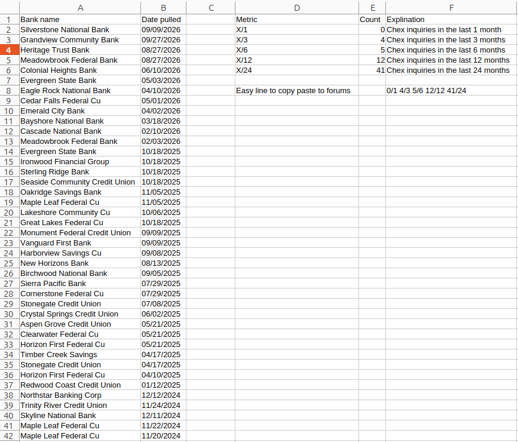
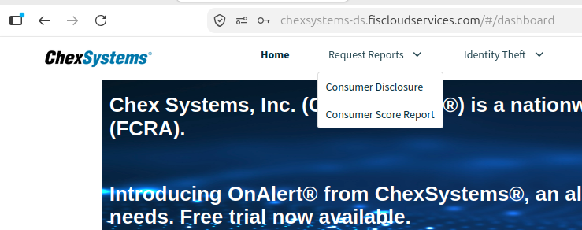

# ChexSystems Inquiries Checker

Your ChexSystems report is a specialized consumer report that tracks how you have used checking and savings accounts.

This is a simple Python script to parse your official **ChexSystems Consumer Disclosure** report PDF and output a clean, organized CSV spreadsheet containing all your bank inquiries, timeframe statistics (`X/1`, `X/3`, `X/6`, `X/12`, `X/24`), and an easy copy-paste summary line for forums (e.g. Reddit r/churning, Doctor of Credit).

This is helpful as if you open a lot of bank accounts, some banks will start to deny you accounts as they can tell you're probably there for the bonus, etc and won't be there long term. While you can see this from the pdf, there wasn't a great way for me to keep track of how many recent inquiries I had. 

---

## Output Preview

The script generates a CSV spreadsheet (`chexsystems_inquiries.csv`) with all inquiries and common stats Chex-sensitive banks may look at. 



---

## How to Get Your ChexSystems Report

1. Log into your [ChexSystems Consumer Portal](https://www.chexsystems.com/).
2. Hover over **Request Reports** in the top navigation bar.
3. Select **Consumer Disclosure** to request and download your report PDF:



---

## Installation

1. Clone this repository:
   ```bash
   git clone git@github.com:DavidZirinsky/chex-checker.git
   cd chex-checker
   ```

2. Install the required dependencies:
   ```bash
   pip install -r requirements.txt
   ```

---

## Usage

### 1. Test with the included sample

A sanitized demo report (`sample.pdf`) is included so you can test immediately:

```bash
python check.py sample.pdf
```

This will parse the sample inquiries and output `chexsystems_inquiries.csv`.

### 2. Run with your own ChexSystems report

Provide the path to your downloaded ChexSystems PDF:

```bash
python check.py /path/to/your_report.pdf
```

You can optionally specify a custom output CSV filename:

```bash
python check.py /path/to/your_report.pdf my_inquiries.csv
```

*(By default, if no arguments are passed, `check.py` looks for `document-1.pdf` in the current folder and outputs to `chexsystems_inquiries.csv`)*.

---

## Generated Metrics

The output CSV summarizes your inquiries across multiple standard rolling windows:

| Metric | Meaning |
| :--- | :--- |
| **X/1** | Number of ChexSystems inquiries in the last 1 month |
| **X/3** | Number of ChexSystems inquiries in the last 3 months |
| **X/6** | Number of ChexSystems inquiries in the last 6 months |
| **X/12** | Number of ChexSystems inquiries in the last 12 months |
| **X/24** | Number of ChexSystems inquiries in the last 24 months |

It also outputs a ready-to-copy summary line (e.g. `0/1 4/3 5/6 12/12 41/24`) that you can directly paste into banking and churning discussion forums.
